# PWM Floor Heating Thermostat for Home Assistant

[](https://github.com/hacs/default)
[](https://github.com/nitrogene/pwm-floor-heating-thermostat/blob/main/LICENSE)
[](https://github.com/nitrogene/pwm-floor-heating-thermostat/releases)

A predictive, thermodynamic underfloor heating thermostat for Home Assistant, engineered specifically for high thermal inertia heavy slabs (*chape liquide / dalle béton*) and on/off (TOR / *Tout-Ou-Rien*) heating devices: geothermal heat pumps, hydronic manifolds with water return sensors, electrothermal wax actuators, and pellet boilers.

---

## Targeted Heating Systems & Architectures

This integration is purpose-built to solve the acute regulation challenges of **heavy inertia floor heating** powered by **fixed-speed on/off (TOR) actuators**:

### 1. Direct-Expansion & Hydronic Geothermal Systems (Enalsa, Sofath, France Géothermie...)
* **Compressors**: Danfoss (Maneurop M26DX, MT series), Copeland Scroll, Tecumseh.
* **Mechanical & Refrigerant Constraints**:
  * **Mandatory Oil Return (>= 30 min ON)**: Unlike inverter heat pumps, fixed-speed scroll or hermetic reciprocating compressors eject lubrication oil into the refrigeration circuits during operation. In direct-expansion floor loops (hundreds of meters of copper tubing embedded in concrete), it takes **at least 20 to 30 minutes of continuous flow** for the oil to migrate back to the compressor crankcase. Stopping prematurely causes progressive oil starvation and catastrophic mechanical seizure.
  * **Pressure Equalization (>= 15 min OFF)**: After compressor shutdown, High Pressure (HP) and Low Pressure (BP) sides must fully balance before restarting. Starting against a residual differential pressure causes severe motor stall, capacitor degradation, or thermal breaker trips.
  * **Cycle Budget (<= 6 cycles/day)**: Eliminating mechanical fatigue by substituting erratic micro-starts with long, consolidated heat charges.

### 2. Heavy Screed Dalles & High Thermal Inertia
* Designed for 5 to 8 cm screeds (*chape fluide anhydrite, chape ciment, dalle béton armé*).
* Characterized by a **pure dead time of 2 to 3 hours** (theta) before heat reaches the room surface, and a **thermal dissipation time constant of 12 to 20 hours** (tau).

### 3. Hydronic Underfloor Systems with Water Return Sensors
* Loop return temperature sensor directly measures the core slab thermal state with near-zero dead time.
* Hard limit anti-overshoot protection enforcing European standard **DTU 65.14 barefoot comfort limit (28°C max)**.

### 4. Hydronic Manifolds with Electrothermal Wax Actuators
* 230V or 24V Normally Closed (NC) / Normally Open (NO) thermal actuators on distribution manifolds.
* These actuators feature a slow wax-expansion response (3 to 5 minutes to fully open/close), which naturally pairs with this thermostat's slow-cycle PWM modulation (1 to 3 hours PWM periods).

---

## Why standard PID thermostats fail on heavy slabs

Standard PID thermostats (such as `smart_thermostat`) are ill-adapted for heavy underfloor heating:
1. **Dead Time (θ ≈ 2h to 3h)**: Heat takes hours to diffuse through the slab. During this time, the error persists, the integral term saturates (*integral windup*), forcing the heater to run too long and causing massive overshoots (+1.5°C to +2.5°C).
2. **Destructive Compressor Short-Cycling**: PID algorithms frequently oscillate around the setpoint, turning on/off compressors within minutes—severely damaging Danfoss compressors without guaranteed oil return and pressure equalization.
3. **No Tariff Optimization**: Conventional thermostats heat reactively whenever ambient temperature drops, missing the opportunity to store cheap calories in the slab during Off-Peak hours (*Heures Creuses*).

---

## Beyond the Heating Curve (*Loi d'Eau*): Predictive Time-Modulated Quotas

Traditional hydronic heating systems rely on a **Heating Curve (*Loi d'eau*)**, which calculates the supply water temperature dynamically from instantaneous outdoor temperature:
> `T_water_supply = T_setpoint + Slope * (T_setpoint - T_outdoor)`

### Why the classical Heating Curve fails on fixed-speed & heavy slab systems:
1. **Compressors cannot modulate flow temperature**: Fixed-speed scroll or hermetic reciprocating compressors (Danfoss, Copeland) run at **100% capacity or 0%**. In direct-expansion systems, condensing refrigerant enters the slab at a constant thermodynamic condensing temperature (~35°C to 40°C). Flow temperature modulation is physically impossible.
2. **Phase Lag & The Morning Cold Dip**: When a winter night freeze occurs at 04:00 AM, a reactive heating curve responds at 04:00 AM. But with a theta = 2.25 h dead time, heat only emerges into the living space around 06:30 or 07:00 AM—resulting in the infamous morning temperature drop.
3. **Blindness to Tariff Opportunities**: A heating curve forces heating whenever outdoor temperature is cold, regardless of peak electricity pricing.

### The Solution: Unified Predictive Energy-Balance Engine (v0.4.0)
Instead of varying supply temperature or running a blind midnight-reset quota, **`pwm_floor_heating_thermostat` computes a rolling 24-hour thermal demand curve** and tracks energy already propagating through the slab ($E_{\text{transit}}$):
> `P_need(t) = H_eff * f_wind * max(0, T_target - T_ext(t))` [kW]
> `E_net = max(0, ∫ P_need(t) dt - C_eff * (T_cur - T_target) - E_transit)` [kWh]

#### 3-Tier Demand Curve Fallback Cascade (Mandatory `weather_entity` + `outdoor_sensor`)
1. **Tier 1 (`weather_api` — Primary):** Hourly weather forecast curve over the next 24h via `weather.get_forecasts(type="hourly")` (15-min cache, persisted across restarts).
2. **Tier 2 (`outdoor_persistence` — Local Fallback):** Rolling 24h local persistence profile from `outdoor_sensor` when the weather API is unavailable.
3. **Tier 3 (`kalata_derivative` — Degraded Fallback):** Observed passive cooling derivative $dT/dt$ from the Kalata observer ($P \approx -C_{\text{eff}} \cdot dT/dt$) if `outdoor_sensor` is also unavailable or stale.

#### Unified Off-Peak (HC) & Peak (HP) Regulation
* **Off-Peak (HC) End-of-Window Scheduling:** Computes the exact energy required until the next off-peak slot, subtracts current excess room heat and $E_{\text{transit}}$, and schedules the required heating pulse(s) toward the **end of the off-peak window** (minimizing overnight losses and delivering comfort at wake-up). Strictly capped by a configurable `off_peak_comfort_margin` (default **`+0.3°C`**) so rooms never overshoot into the hard ceiling (`+1.0°C`).
* **Peak (HP) Strict Top-Up:** Only triggers short top-up cycles (`peak_max_run_duration`, default `45 min`) if the trajectory drops **and** an energy deficit is predicted before the next off-peak window (preserving `-1.5°C` emergency and `-0.8°C` comfort safety overrides).

#### Zero-Impact Home Assistant Restart Persistence
All time-stamped model state is persisted in Home Assistant's `Store` (`.storage/pwm_floor_heating.<unique_id>`) and flushed on `EVENT_HOMEASSISTANT_STOP`: Danfoss FSM locks (`30 min` ON / `15 min` OFF), timestamped slab energy-in-transit pulses (`E_transit`), rolling 24h `outdoor_sensor` history, cached hourly weather curve, Kalata observer state, and open-window / post-airing recovery windows (`_window_recovery_until`). Elapsed downtime is accurately subtracted on boot.

#### Companion Diagnostic Sensors (`v0.4.0`)
| Sensor Key | Unit / Type | Description |
| :--- | :--- | :--- |
| `temp_projected_ahead` | °C | Projected room temperature at $t + \theta_{\text{eff}}$ |
| `temp_derivative_hourly` | °C/h | Smoothed Kalata hourly temperature slope |
| `model_error` / `model_error_rms` | °C | Live prediction error and 24h passive-cooling RMS |
| `forecast_energy_need_24h_kwh` | kWh | Rolling 24h integral of the demand curve $P_{\text{need}}(t)$ |
| `slab_energy_in_transit_kwh` | kWh | Thermal energy currently propagating through the slab ($E_{\text{transit}}$) |
| `planned_heating_hours` | h | Remaining compressor runtime required over the active horizon |
| `heat_loss_measured_wk` | W/K | Empirically measured heat loss $H$ (Mode A night cooling) |
| `fsm_state` | enum | Compressor state (`idle`, `running_min_lock`, `running_normal`, `waiting_min_off`) |
| `next_transition_time` | timestamp | Predicted next turn-on or turn-off timestamp |
| `decision` | enum | Translated decision reason (`off_peak_precharge`, `off_peak_deferred`, `energy_balance_satisfied`, `anticipated_drop`, etc.) |

#### Migration Guide (`v0.3.x` → `v0.4.0` Breaking Changes)
* `weather_entity` is now **required** alongside `outdoor_sensor` in ConfigFlow / OptionsFlow.
* Legacy midnight quota options and entities (`enforce_daily_quota`, `enforce_daily_quota_sensor`, `energy_quota_24h_kwh`, `heating_hours_remaining_24h`, `daily_quota_blocked`, `unserved_quota_carryover_hours`, `use_weather_forecast_average`) have been removed and replaced by `forecast_energy_need_24h_kwh`, `slab_energy_in_transit_kwh`, `planned_heating_hours`, `off_peak_comfort_margin`, `off_peak_end_entity`, and `off_peak_duration_hours`. Update Lovelace dashboards accordingly.

---

## Key Features

- 🏗️ **Thermodynamic Slab Model**: Predicts the daily heat deficit based on outdoor temperature (current and forecast) and room heat loss ($H$ in W/K, configurable down to 1.0 W/K with 0.1 W/K granularity).
- 🧠 **Mode B Two-Stage Self-Adaptation**: Unifies three heat loss representations:
  - **Baseline / Initial $H$**: Configured reference value used at startup.
  - **Measured $U \cdot A$ (Mode A)**: Empirically estimated from unheated night decay slopes.
  - **Effective $H_{\text{eff}}$**: Injected into the daily energy quota equation. Automatically shifts from a $\pm 20\%$ safety clamp (initial ramp-up $3 \le N < N_{\text{confidence}}$) to **direct unconstrained application** ($N \ge N_{\text{confidence}}$, configurable default: 10 samples), letting real-world physics prevail.
- ⏱️ **Predictive Dead-Time Anticipation**: Projects the slab's internal thermal wave to prevent cold morning drops without overshooting.
- 🛡️ **Danfoss Compressor Safety Guard**: Built-in, non-bypassable FSM:
  - Minimum ON cycle: 30 minutes (ensures complete oil return).
  - Minimum OFF cycle: 15 minutes (ensures refrigerant pressure equalization).
  - Daily cycle budget limit (e.g. maximum 6 cycles/day).
- 💧 **Hydronic Water Circuit Feedback**: Optional `floor_temp_sensor` monitoring the loop return water temperature for DTU 65.14 max floor temperature cutoffs (28°C) and freeze protection.
- ⚡ **Dynamic Off-Peak (*Heures Creuses*) Scheduling**: Prioritizes running long charging cycles when electricity is cheapest (Linky TIC / dynamic sensor integration).
- 👻 **Shadow Mode / Digital Twin (Dry-Run)**: Run in parallel with an existing legacy thermostat without actuating physical relays to compare theoretical decisions against real curves before live switchover.
- 🔍 **AI Auto-Tuning & Telemetry**: Exposes model error e_model, trajectory projections, energy quota, passive cooling rates, and FSM diagnostics for automated calibration via AI agents or analytics.
- 🔄 **Restart-Resilient**: Inherits `RestoreEntity`—restores running state, elapsed timers, and cycle counts after Home Assistant reboots.

---

## Installation

### Via HACS (Recommended)

As an official integration included in the HACS default catalog:

1. Open **HACS** in your Home Assistant instance.
2. Search for **PWM Floor Heating Thermostat** under the **Integrations** tab.
3. Click **Download**, then restart Home Assistant.

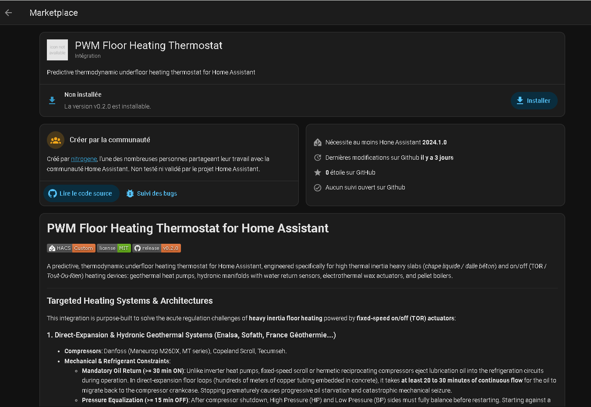

> *Optional fallback:* If not yet indexed in your local HACS cache, click the three dots ⋮ in the top right corner -> **Custom repositories** -> add `https://github.com/nitrogene/pwm-floor-heating-thermostat` as an **Integration**.

### Manual Installation

Copy all files into `<home_assistant_config>/custom_components/pwm_floor_heating_thermostat/` and restart Home Assistant.

---

## Configuration via User Interface (Config Flow)

Setting up your thermostat is fully supported directly in the Home Assistant UI without writing any YAML:

1. Navigate to **Settings** -> **Devices & Services** -> **Add Integration**.
2. Search for **PWM Floor Heating Thermostat**.
3. **Step 1 - Entity Mapping:** Name your thermostat and select your ambient sensor, outdoor sensor (or forecast sensor), heating actuator relay, and optional off-peak tariff sensor:

| Initial Selection | Filled Form |
| :---: | :---: |
| 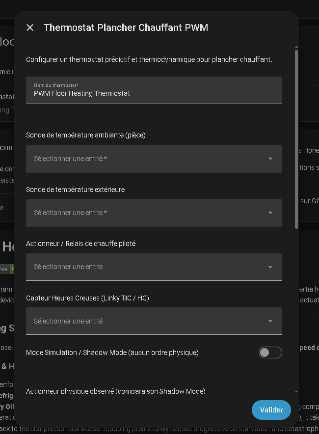 | 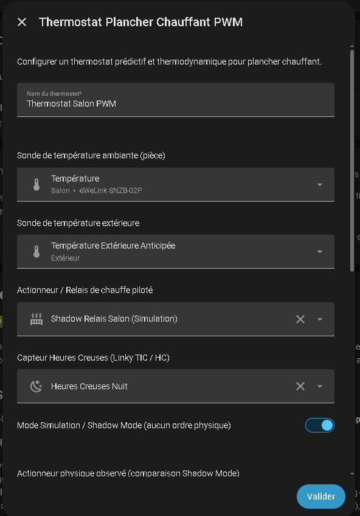 |

4. **Step 2 - Thermodynamic Parameters:** Enter the baseline / initial heat loss coefficient $H$ (range: 1.0 to 300.0 W/K, step: 0.1 W/K), heating output $P$, slab time constant $\tau$, and dead time $\theta$:

| Parameters Form | Configured Parameters |
| :---: | :---: |
| 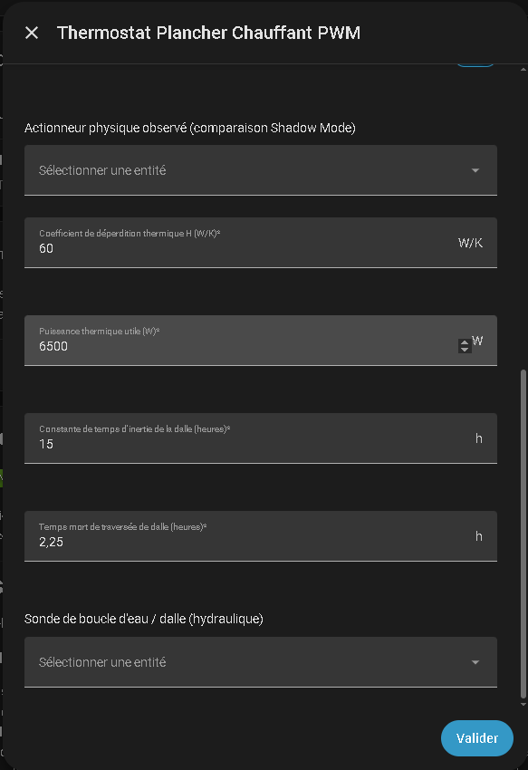 | 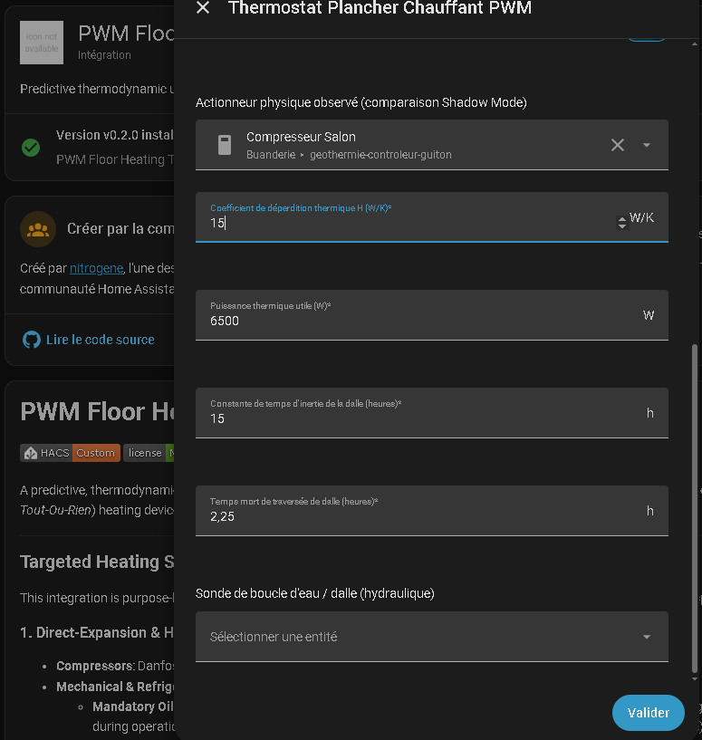 |

5. **Step 3 - Device Registry:** Assign the thermostat to an area. A dedicated Home Assistant device card and climate entity are instantly created:

| Device Registration | Device Card Overview |
| :---: | :---: |
| 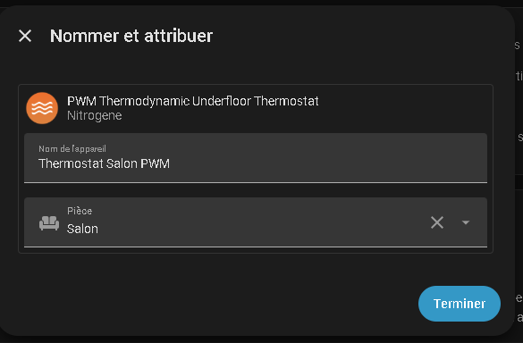 | 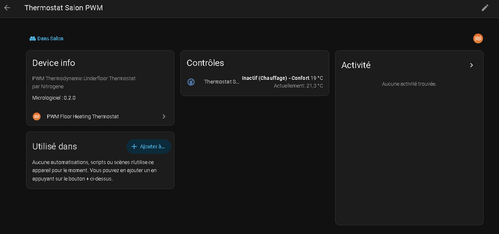 |

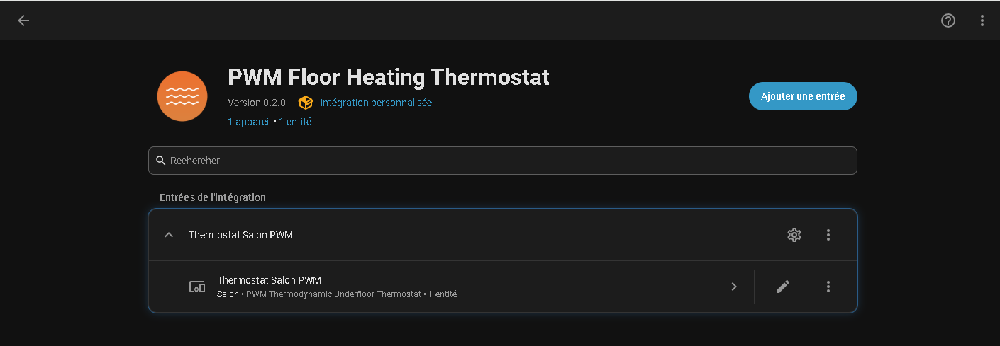

---

## Dynamic Options Flow (Runtime Tuning)

You can recalibrate any thermodynamic parameter or toggle between **Shadow Mode** and **Live Physical Control** at any time without restarting Home Assistant:
- Navigate to **Settings** -> **Devices & Services** -> **PWM Floor Heating Thermostat** -> click the **Configure** (gear icon ⚙️) button.

| Options Flow - General & Presets | Options Flow - Slab & Staggering |
| :---: | :---: |
| 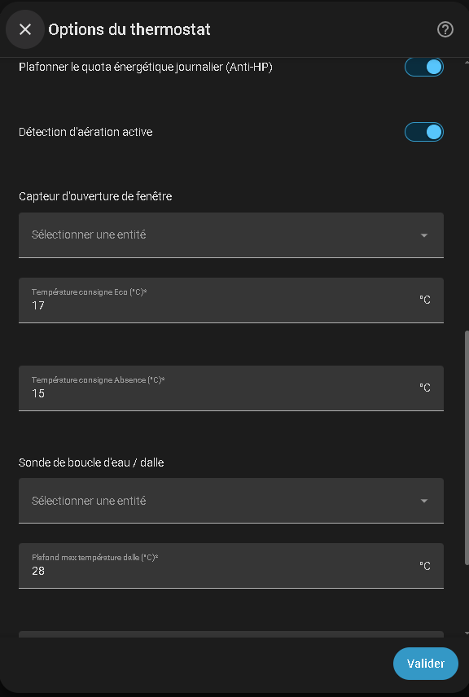 | 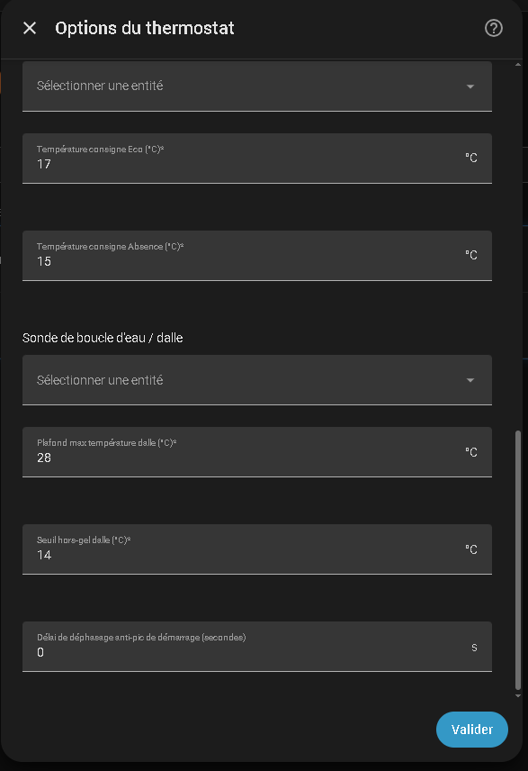 |

---

## YAML Configuration Examples (Alternative)

### 1. Geothermal Heat Pump (Direct Expansion / TOR Compressors)

```yaml
climate:
  - platform: pwm_floor_heating_thermostat
    name: "Living Room Geothermal"
    heater: switch.living_room_compressor_relay
    target_sensor: sensor.living_room_temperature
    outdoor_sensor: sensor.outdoor_temperature_forecast
    weather_entity: weather.home
    off_peak_sensor: binary_sensor.off_peak_electricity_tariff # Optional: French Linky TIC or energy tariff
    off_peak_comfort_margin: 0.3                               # Max °C above target during Off-Peak charging
    
    # Building thermal characteristics
    heat_loss_wk: 60.0          # Thermal loss rate (W/K)
    power_watts: 6500.0         # Useful heat output (W) - e.g. 2x Danfoss M26DX
    slab_tau_hours: 15.0        # Slab thermal time constant (hours)
    dead_time_hours: 2.25       # Dead time for heat wave diffusion (hours)
    
    # Mechanical compressor protections (Danfoss specifications)
    min_cycle_duration: "00:30:00"      # Minimum ON time (30 min for oil return)
    min_off_cycle_duration: "00:15:00"  # Minimum OFF time (15 min for pressure balance)
    max_cycles_per_day: 6
    
    # Setpoints
    target_temp: 19.0
    min_temp: 16.0
    max_temp: 26.0
```

### 2. Hydronic Floor Heating with Water Return Sensor

For hydronic systems with a temperature probe clamped to the floor loop return pipe:

```yaml
climate:
  - platform: pwm_floor_heating_thermostat
    name: "Kitchen Hydronic Floor"
    heater: switch.kitchen_underfloor_actuator
    target_sensor: sensor.kitchen_ambient_temperature
    outdoor_sensor: sensor.outdoor_temperature
    off_peak_sensor: binary_sensor.off_peak_electricity_tariff
    
    # Hydronic loop temperature monitoring
    floor_temp_sensor: sensor.kitchen_water_return_temperature # Loop return probe
    max_floor_temp: 27.5                                       # Hard cutoff (DTU 65.14 standard)
    min_floor_temp: 14.0                                       # Slab freeze protection
    
    # Shorter cycles adapted for manifold wax actuators
    min_cycle_duration: "00:15:00"
    min_off_cycle_duration: "00:10:00"
    heat_loss_wk: 45.0
    power_watts: 3200.0
    dead_time_hours: 1.5
```

### 3. Shadow / Simulation Mode (Dry-Run in parallel with existing PID)

Run safely alongside an existing PID or manual thermostat. The model will calculate everything, record state, and report why and when it would have started heating—**without triggering the physical switch**:

```yaml
climate:
  - platform: pwm_floor_heating_thermostat
    name: "Living Room Simulation Shadow"
    target_sensor: sensor.living_room_temperature
    outdoor_sensor: sensor.outdoor_temperature_forecast
    weather_entity: weather.home
    off_peak_sensor: binary_sensor.off_peak_electricity_tariff
    off_peak_end_entity: input_datetime.off_peak_end          # Optional: end of Off-Peak window for end-of-HC scheduling
    off_peak_comfort_margin: 0.3                              # Max °C above target during Off-Peak charging
    
    # Shadow mode configuration
    dry_run: true                                          # Disables physical relay switching!
    heater: input_boolean.living_room_simulated_relay      # Optional: virtual helper to visualize simulated state
    observed_heater: switch.living_room_compressor_relay   # Observe what the existing PID is currently doing
    
    heat_loss_wk: 60.0
    power_watts: 6500.0
    slab_tau_hours: 15.0
    dead_time_hours: 2.25
    
    # Open Window / Rapid Ventilation Detection
    window_detection: true                                 # Inhibit heating during rapid temperature drops or open window
    window_detection_sensor: input_boolean.window_detection_living_room # Optional: toggle switch in Lovelace UI
    # window_sensor: binary_sensor.living_room_window_contact # Optional: physical magnetic contact sensor
    window_drop_threshold: 0.4                             # °C drop over 15 min to trigger suspension
    window_timeout: "00:30:00"                             # Auto-resume timeout
    
    # Presets & Multi-Zone Staggering
    eco_temp: 17.0                                         # Preset Eco setpoint
    away_temp: 15.0                                        # Preset Away setpoint (extended absence)
    stagger_delay: "00:00:00"                              # Startup delay to stagger multiple zones (e.g. "00:05:00")
```

> [!NOTE]
> **French Linky TIC users:** For backward compatibility, `heures_creuses_sensor` can be used as a direct alias for `off_peak_sensor` (e.g. `heures_creuses_sensor: binary_sensor.heures_creuses_nuit`).

---

## Troubleshooting & Diagnostics

### 1. Enabling Debug Logs

To view detailed cycle scheduling decisions, thermodynamic calculations, and FSM transitions, enable debug logging in your Home Assistant `configuration.yaml`:

```yaml
logger:
  default: info
  logs:
    custom_components.pwm_floor_heating_thermostat: debug
```

After updating `configuration.yaml`, reload the logger configuration or restart Home Assistant.

### 2. Downloading Diagnostics (Sanitized)

If you encounter unexpected regulation behavior or wish to share your model state for assistance:
1. Navigate to **Settings** -> **Devices & Services** -> **PWM Floor Heating Thermostat**.
2. Click on your thermostat device (or the three dots next to the entry) and select **Download diagnostics**.
3. Home Assistant will export a sanitized JSON file containing entry configuration, live model attributes, Danfoss FSM timers, and telemetry metrics (all passwords, tokens, and sensitive keys are automatically redacted).

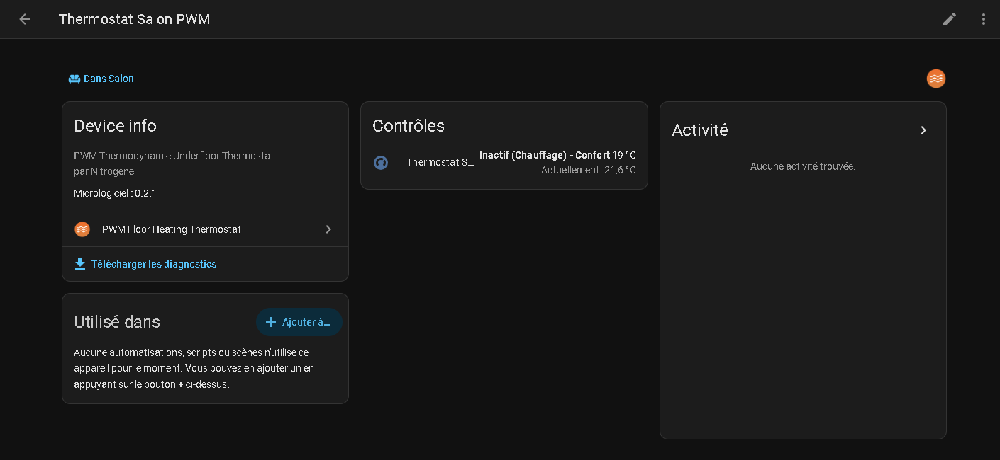

Sample sanitized export preview:
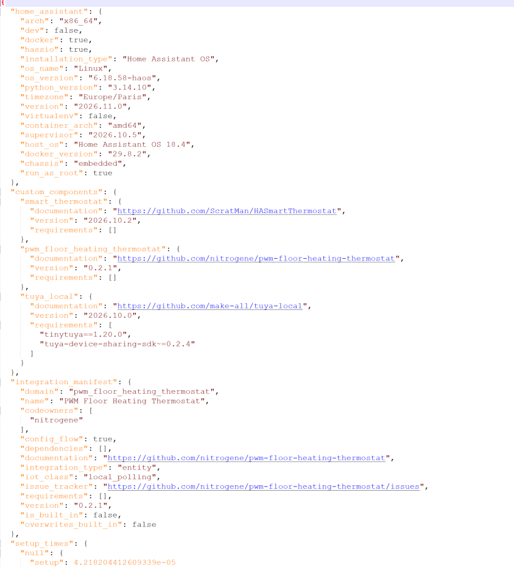

### 3. Filing an Issue

If you find a bug or have a feature request:
- Open an issue on GitHub: [Submit an Issue](https://github.com/nitrogene/pwm-floor-heating-thermostat/issues/new/choose).
- Use the **Bug Report** template and attach your sanitized `diagnostics.json` along with relevant debug log extracts.

---

## License

MIT License - Copyright (c) 2026 Nitrogene.
